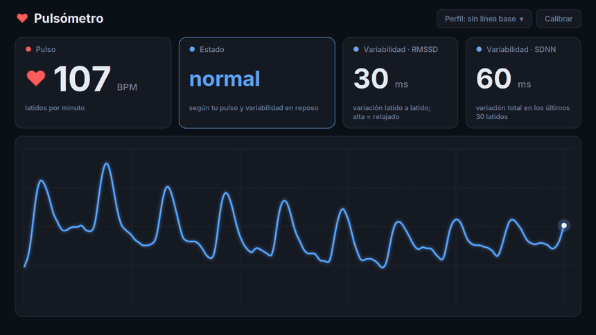
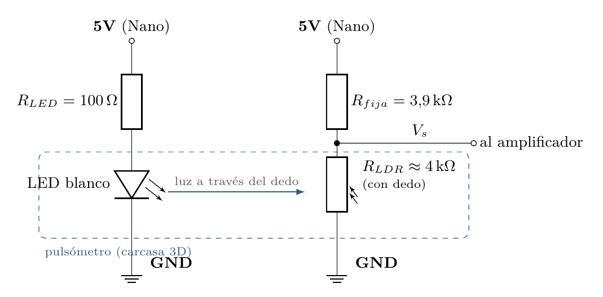
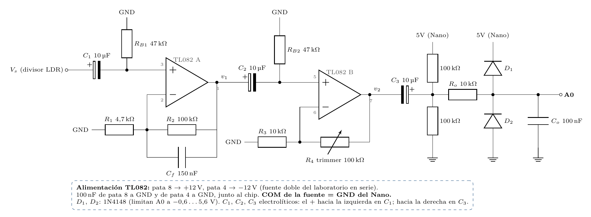

# Pulsómetro PPG con Arduino Nano

Pulso, variabilidad cardiaca (HRV) y nivel de estrés en tiempo real, a partir de la luz que
atraviesa el dedo.

<p align="center">
  
</p>

*PPG heart-rate monitor: LED + LDR sensor, TL082 analog front end and an Arduino Nano that
detects every beat and computes BPM, HRV and a stress indicator on-chip.*

## Circuito

**Sensor.** El LED ilumina el dedo y la LDR recoge la luz que lo atraviesa. Con cada latido
llega más sangre y menos luz: $R_{LDR}$ sube y $V_s$ sube unos milivoltios.

<p align="center"></p>

**Amplificador.** Dos etapas con un TL082 a ±12 V. Cada una quita la continua (paso alto
de 0,34 Hz) y amplifica; la primera además filtra por encima de ~11 Hz. Ganancia total 68,5:
el pulso pasa de milivoltios a 1,5-2 V. A la salida, el divisor de 100 kΩ centra la señal en el
rango del ADC, $D_1$-$D_2$ protegen A0 y $R_o$-$C_o$ es el antialiasing.

<p align="center"></p>

<table>
  <tr>
    <td></td>
    <td></td>
  </tr>
</table>

[Vídeo del montaje funcionando](docs/demo_hardware.mp4)

## Firmware

Todo el cálculo se hace en el Arduino:

1. **Muestreo** a 500 Hz con el Timer1.
2. **Detección de latidos**: umbral adaptativo que ignora la onda dícrota. El latido se fecha
   en la máxima pendiente de subida, con precisión de milisegundos.
3. **BPM, RMSSD y SDNN** sobre los últimos 30 latidos, descartando artefactos.
4. **Estado** relajado / normal / estrés, comparado con una calibración de 2 min en reposo.

El PC solo muestra los datos y los graba ([`pc/visor.py`](pc/visor.py)).

## Resultados

| | Resultado |
|---|---|
| Muestreo | 500,39 Hz, 0 muestras perdidas |
| BPM | 77,6 frente a 79 de una app de referencia |
| HRV con RR conocidos | RMSSD 100,9 ms (esperado 100) |
| Estado | estrés al apretar el puño, relajado al relajarse |

## Uso

```sh
arduino-cli compile -u -p /dev/ttyUSB0 --fqbn arduino:avr:nano:cpu=atmega328old firmware/pulso

cd pc && pip install -r requirements.txt
python visor.py --produccion
python visor.py --produccion --reproducir ../datos/sesion_20261124_125442.csv   # sin montaje
```

El [informe](informe/Informe_Trabajo_Final.pdf) explica el diseño completo y las medidas.

Trabajo final de Sistemas Digitales (Universidad de Zaragoza, 2026) · [MIT](LICENSE) ©
Ernest Tarrús
