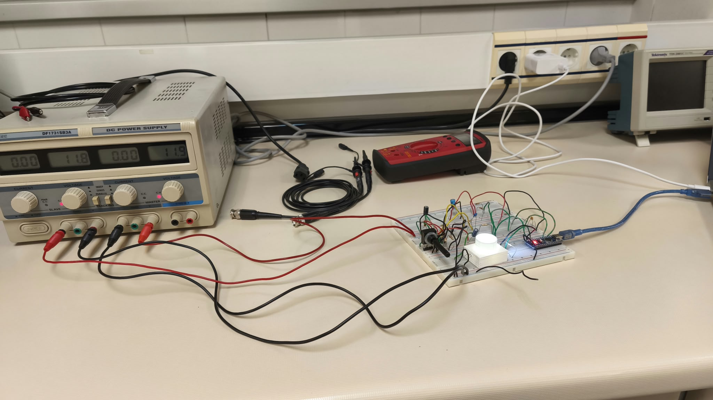
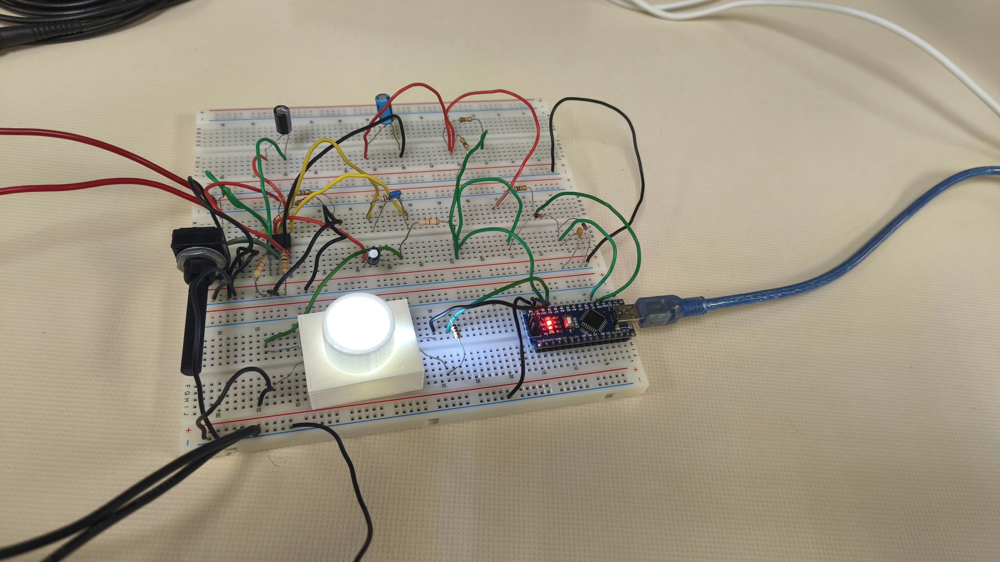
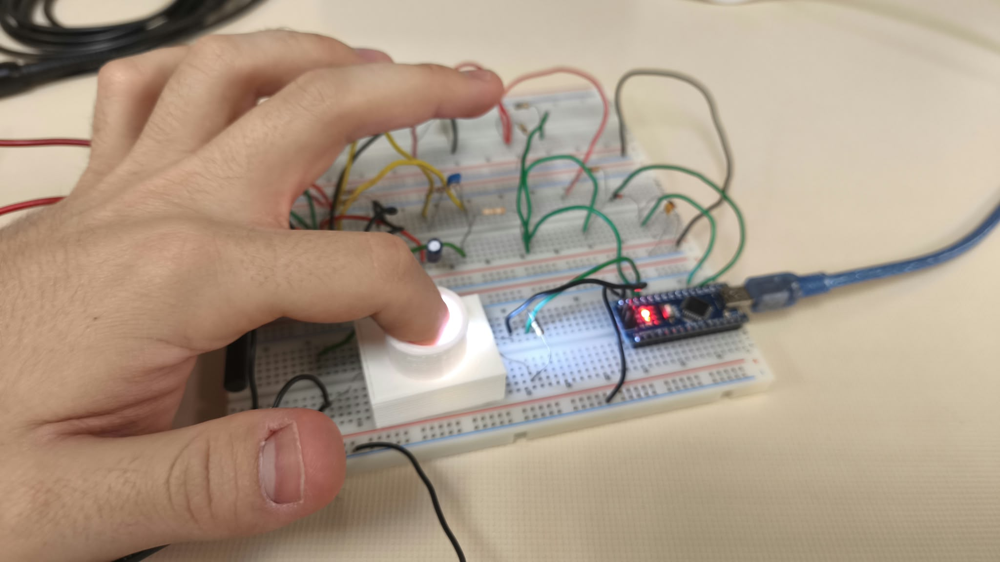
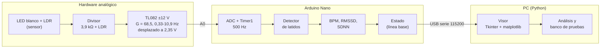
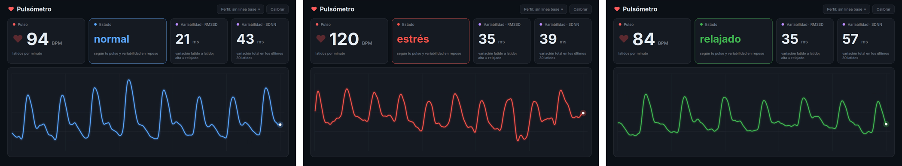

# Pulsómetro PPG con Arduino Nano

**Lectura del pulso cardiaco por fotopletismografía: detección de latidos, BPM, variabilidad
(HRV) e indicador de estrés en tiempo real.**


<p align="center">
  
</p>

> **English summary.** A photoplethysmography (PPG) heart-rate monitor built from scratch for a
> Digital Systems course: an LED + LDR finger sensor, a two-stage TL082 analog front end
> (gain 68.5, 0.33-10.9 Hz), and an Arduino Nano that samples at 500 Hz on a timer
> interrupt, detects every beat, and computes BPM, HRV (RMSSD, SDNN) and a personal
> relaxed / normal / stress indicator, all on the microcontroller with exact integer math. A
> Python viewer shows the waveform at 20-25 fps. The firmware's processing modules are
> plain C++ and are also compiled on the PC to test them against real recordings and synthetic
> signals with known RR intervals.

## Qué hace

- **Adquiere** la señal del dedo a 500 Hz exactos (interrupción del Timer1, 0 muestras perdidas).
- **Detecta cada latido** con un umbral adaptativo y una máquina de estados que ignora la onda
  dícrota. El instante del latido se toma en la máxima pendiente de subida, con
  interpolación parabólica: precisión de pocos milisegundos.
- **Calcula en el propio Arduino** el pulso (BPM), RMSSD y SDNN sobre los últimos 30 latidos,
  con rechazo de artefactos y aritmética entera exacta.
- **Indica el estado** {relajado, normal, estrés} respecto a una línea base personal (2 min de
  calibración en reposo, guardada en la EEPROM y en perfiles con nombre).
- **Muestra** la onda y las cifras en un visor de escritorio con dos modos: *test* (tacograma,
  artefactos, fps) y *producción* (el de arriba, para demostraciones).

## Montaje

<table>
  <tr>
    <td colspan="2"></td>
  </tr>
  <tr>
    <td width="50%"></td>
    <td width="50%"></td>
  </tr>
</table>

Vídeo del sistema funcionando: [`docs/demo_hardware.mp4`](docs/demo_hardware.mp4).

## Arquitectura



Todo el procesado se hace en el Arduino; el PC solo visualiza y registra.

| Bloque | Implementación |
|---|---|
| Sensor | LED blanco (100 Ω desde 5 V, ~20 mA) y LDR. Divisor 3,9 kΩ + LDR (~4 kΩ con el dedo) |
| Acondicionamiento | TL082 a ±12 V. Etapa 1: paso alto 0,33 Hz, G = 22,6 y paso bajo 10,9 Hz. Etapa 2: paso alto y G = 3,03 (potenciómetro). Salida desplazada al centro del ADC, diodos 1N4148 de protección y antialiasing de 162 Hz |
| Adquisición | Timer1 en modo CTC a 500 Hz, ISR con buffer circular de 256 muestras |
| Detector | Media móvil de 20 ms (ceros en 50 Hz), umbral adaptativo con decaimiento, periodo refractario adaptativo, latido en la máxima pendiente de subida |
| HRV | Rechazo de RR fuera de 300-2000 ms o a más del 30 % del anterior; ventana de 30 RR; varianza entera exacta |
| Estado | Estrés si el pulso sube ≥ 10 BPM sin subir la HRV, ≥ 15 BPM, o si el RMSSD cae a la mitad; relajado si el RMSSD sube un 15 % con el pulso en reposo; histéresis de 10 latidos |
| PC | Visor a 20-25 fps con *blitting*, grabación en CSV, perfiles; análisis de sesiones; banco de pruebas del firmware |

## Resultados

| Funcionalidad | Criterio | Resultado |
|---|---|---|
| Adquisición | 500 Hz sin pérdidas | 500,39 Hz medidos; 0 muestras perdidas en todas las sesiones |
| Detección | Sin latidos perdidos ni duplicados en reposo | 89 latidos en 60 s, igual que un contador de picos independiente |
| BPM | Error ≤ 2 BPM | 77,6 frente a 79 BPM de una app de móvil |
| HRV | Error ≤ 2 ms con RR conocidos | RMSSD 100,9 y SDNN 51,4 ms (esperado 100 y 50,9) |
| Onda en tiempo real | ≥ 20 fps | 20-25 fps, retraso estable |
| Estado | Tendencia esperada | Estrés al apretar el puño, relajado al relajarse; probado con dos personas |

La misma prueba con la línea base del día: normal en reposo, estrés al apretar el puño y
relajado al final. La onda toma el color del estado.



Las líneas base de dos personas fueron muy distintas (66 BPM y RMSSD 69 ms frente a 91 BPM y
28 ms), y la misma persona cambió 8 BPM de un día a otro. Por eso el estado se decide respecto
a una calibración personal y no con umbrales fijos.

## Uso

**Firmware** (`firmware/pulso/`). Para un Nano clónico con bootloader antiguo:

```sh
arduino-cli compile --fqbn arduino:avr:nano:cpu=atmega328old firmware/pulso
arduino-cli upload  --fqbn arduino:avr:nano:cpu=atmega328old -p /dev/ttyUSB0 firmware/pulso
```

**PC** (`pc/`):

```sh
cd pc
python -m venv .venv && .venv/bin/pip install -r requirements.txt
source .venv/bin/activate

python visor.py                        # modo test: onda, tacograma, métricas, marcas de fase
python visor.py --produccion           # pantalla limpia para demostraciones (F11: completa)
python analisis.py ../datos/sesion_x_latidos.csv [fig.png] [--desde S] [--hasta S]
python sintetica.py salida.csv rr_verdad.csv <BPM|arritmia|alterna|perdidos|protocolo>
```

**Sin el montaje** se puede ver una grabación real (reposo, prensión del puño y relajación):

```sh
python visor.py --produccion --reproducir ../datos/sesion_20261124_125442.csv
```

**Banco de pruebas.** Compila el detector, la HRV y el estado del firmware en el PC y los
ejecuta sobre una grabación o una señal sintética:

```sh
g++ -O2 -I../firmware/pulso -o test_detector test_detector.cpp ../firmware/pulso/{detector,hrv,estado}.cpp
./test_detector ../datos/sesion_20261124_125442.csv 10 latidos.csv
```

Con el Nano conectado, el visor graba siempre la sesión en `datos/` (señal, latidos y marcas de
fase con la barra espaciadora). **Calibrar** pide un nombre y guarda la línea base como perfil;
elegir un perfil en el menú lo carga en el Nano.

### Protocolo serie (115200 baudios, ASCII)

| Sentido | Mensaje | Significado |
|---|---|---|
| Nano → PC | `S,t,adc` | Señal filtrada a 100 Hz |
| Nano → PC | `B,t,rr,res,bpm,rmssd,sdnn,estado` | Cada latido: instante, RR, resultado del rechazo, métricas y estado |
| Nano → PC | `I,texto` | Información: arranque, línea base, calibración, estadísticas |
| PC → Nano | `c` / `r` / `o` | Calibrar / reiniciar el detector / olvidar la línea base |
| PC → Nano | `b<hr0×10>,<rmssd0×10>` | Cargar la línea base de un perfil |

## Estructura

```
firmware/pulso/      sketch final: adquisicion, detector, hrv, estado y pulso.ino
firmware/pruebas/    prueba de la adquisición a 500 Hz
pc/                  visor, análisis, señales sintéticas y banco de pruebas
datos/               grabaciones reales de ejemplo (CSV)
informe/             informe (PDF y LaTeX), figuras y notas de cada módulo con las medidas
plan/                plan de desarrollo por módulos (M0-M9)
fotos/, docs/        fotos del montaje, capturas y vídeo
```

El [informe](informe/Informe_Trabajo_Final.pdf) explica el diseño de cada bloque con los
valores medidos, la validación y los problemas que aparecieron por el camino.

## Contexto

Trabajo final de la asignatura Sistemas Digitales (Universidad de Zaragoza, 2026). El
indicador de estado es orientativo: no es un dispositivo médico.

## Licencia

[MIT](LICENSE) © 2026 Ernest Tarrús
